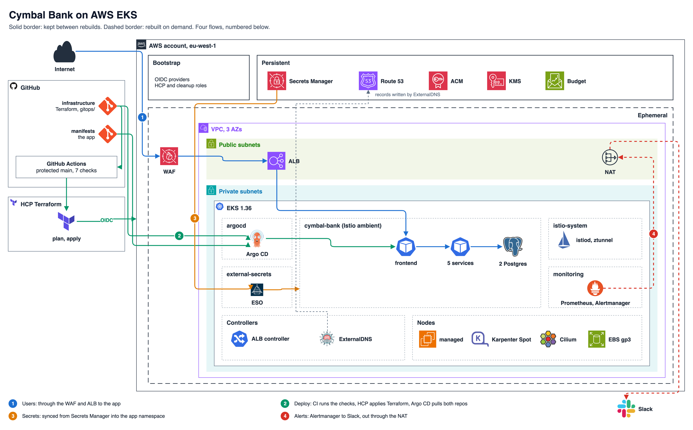
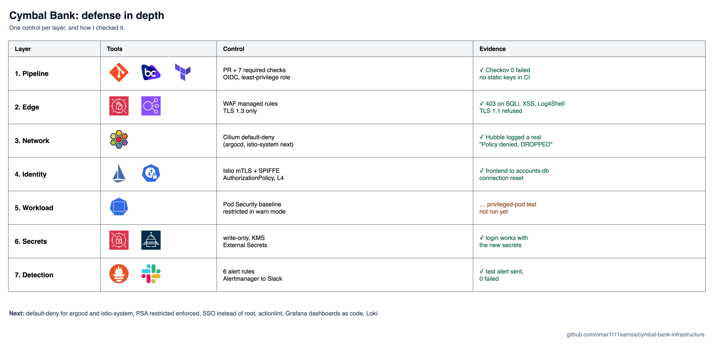
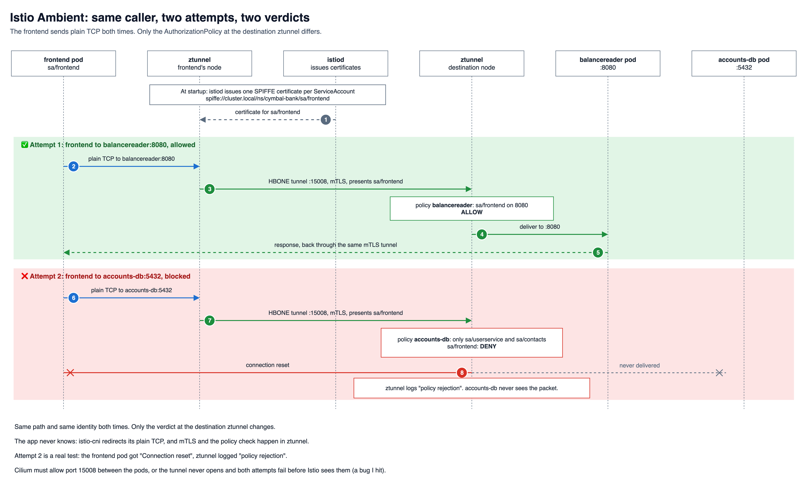

# Cymbal Bank Infrastructure

Zero-trust, cloud-native banking microservices platform deployed on AWS EKS using Terraform, HCP Terraform, Cilium (eBPF), and Istio Ambient Mesh.

## Architecture

1. **Users**: through the WAF and the ALB (TLS 1.3) to the frontend, then the backend services and the two Postgres databases.
2. **Deploy**: every change is a PR with 7 required checks. HCP Terraform applies the AWS side over OIDC, and Argo CD pulls the cluster side from both repos.
3. **Secrets**: generated write-only by Terraform, stored in Secrets Manager (KMS), synced into the app namespace by External Secrets.
4. **Alerts**: Prometheus rules fire, Alertmanager sends them to Slack through the NAT.

## Defense in depth

## Deep dive: one call through the mesh

The diagram sources (`.drawio`) live next to the images in [`docs/`](docs/).

## Layout

| Path | What | Applied by |
|---|---|---|
| `terraform/bootstrap/` | OIDC trust (HCP, GitHub), HCP workspaces, CI roles, `main` ruleset | locally, by hand (local state) |
| `terraform/persistent/` | DNS zone, TLS certificate, secrets, KMS keys: survives destroys | HCP workspace `cymbal-bank-persistent` |
| `terraform/ephemeral/` | VPC, EKS, Cilium, Karpenter, ArgoCD: destroyed and rebuilt | HCP workspace `cymbal-bank-prod` |
| `gitops/` | everything inside the cluster, synced by ArgoCD | ArgoCD |
| `.github/workflows/` | checks on every PR, build on merge, destroy on demand | GitHub Actions |
